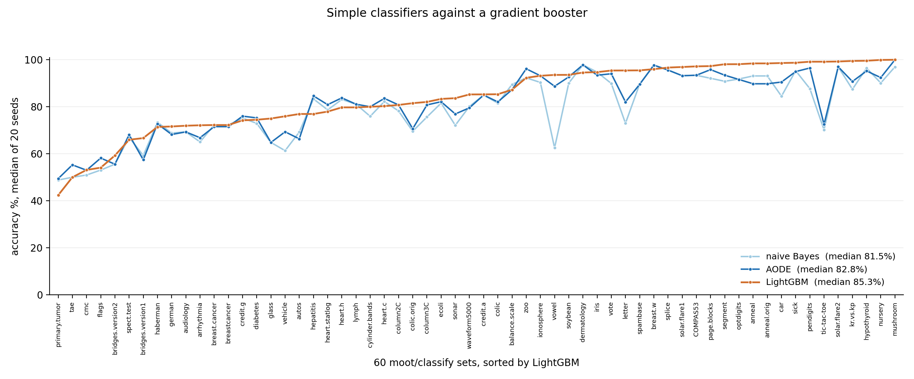
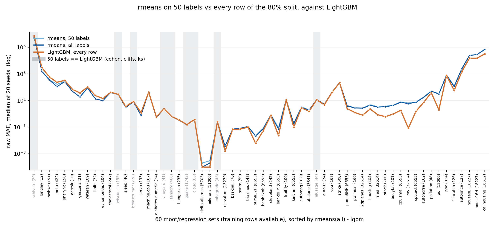
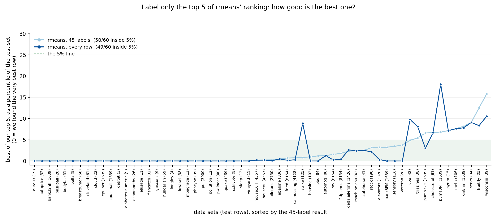
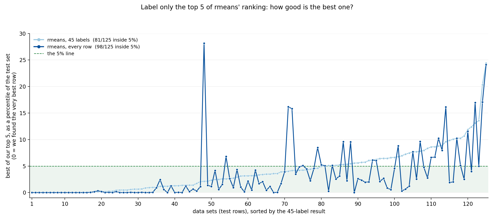
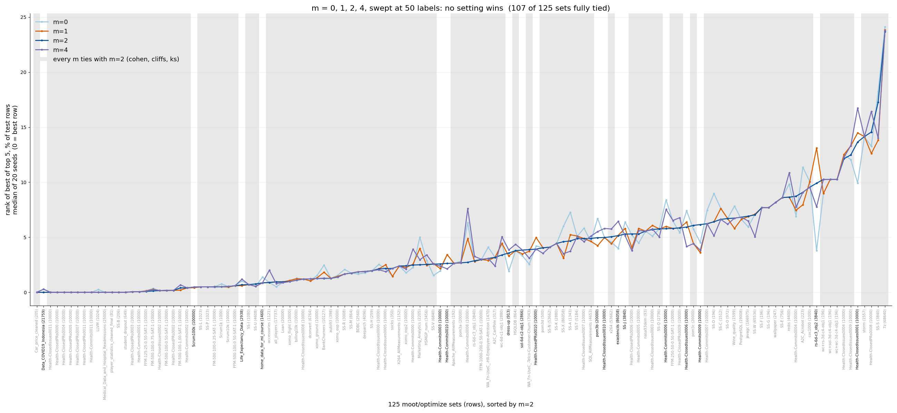
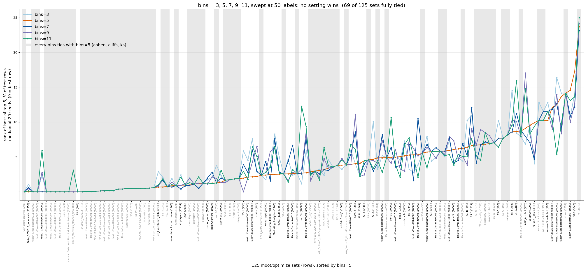
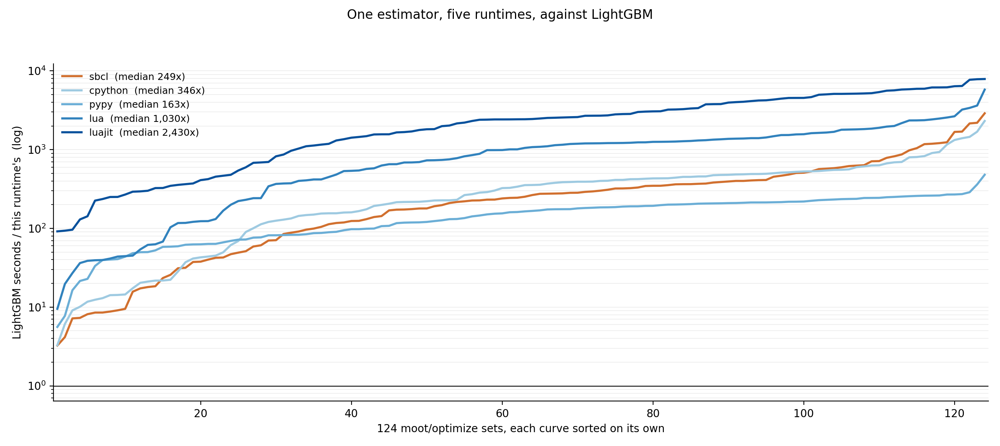

# rq: how simple can a learner be?

Three claims, one estimator, 244 lines of Common Lisp:

1. **Simple classifiers work fine.** Naive Bayes over binned
   columns lands within a point or three of LightGBM.
2. **Simple regression works fine.** The same bins, averaged by
   variance reduction (`rmeans`), tracks a gradient booster at a
   small constant factor -- and stops needing data at about a
   hundred labels.
3. **Simple optimisers built on that regression are fine.**
   Rank the unseen rows by the guess, pay for five labels, and
   two thirds of the time you hold a top-5% row.

None of this is new in kind -- the lineage runs from Holte's 1R
through discretized naive Bayes -- but it is measured here under
one protocol, in one small program, against a current booster.

## The code

`min.lisp` (244 lines) is the whole learner: csv reader, column
summaries, bins, `rmeans`, and the three statistical tests that
police the results.  `arms.lisp` (190) is the harness.  No
libraries: no numpy, no pandas, no ezr.  Runs on SBCL and CLISP,
which agree to the last digit on every number below.

## The rigs

*Classification* (`etc/nb60b17.tsv`, `etc/aode60b5.tsv`,
`etc/lgbm60.tsv` from the ezr repo).  60 `moot/classify` sets,
20 seeds, accuracy.

*Regression* (`arms.lisp -learn`, `-rank`).  60
`moot/regression` sets on the frozen 80:20 splits of
`etc/rcache.py`, 20 seeds, raw MAE on the held-out rows.  The
target is the raw `!` cell, so both arms are scored by identical
arithmetic.  LightGBM's predictions come from the cache; it
always reads every training row.

*Optimisation* (`arms.lisp -opt1`).  125 `moot/optimize` sets,
`y` = `ydist`, the distance to heaven over **all** goal columns.
Budget is ezr's own: `Stop=50`, `Check=5`, so 45 rows train the
model and 5 more pay to look at the top of its ranking.

Everything is the **median of 20 repeats**.  "Tied" means
`same`: Cohen's d <= 0.35 **and** Cliff's delta <= 0.195 **and**
Kolmogorov-Smirnov <= 1.36, all three agreeing.

## RQ1: do simple classifiers work?



| arm | wins | ties | losses | median accuracy |
|---|---|---|---|---|
| naive Bayes | 9 | 11 | 40 | 81.5% |
| AODE | 13 | 11 | 36 | 82.8% |
| LightGBM | -- | -- | -- | 85.3% |

- **LightGBM wins more often, by very little.**  The median
  accuracy gap is **3.3 points** for naive Bayes and **1.4** for
  AODE.  Counting wins makes the booster look dominant; the
  profile shows two curves a hair apart.
- **Tied or better on 20 of 60** (naive Bayes) and **24 of 60**
  (AODE).  Relaxing independence a little -- AODE's one-level
  dependence -- recovers nearly half the remaining gap.
- The curves only separate at the hard end.  Where LightGBM is
  above 95% the simple learners are too.

## RQ2: do simple regressors work?



`rmeans`, raw MAE, against LightGBM reading all of the 80%:

| rmeans trained on | better | tied | worse |
|---|---|---|---|
| 50 labels | 13 | 9 | 38 |
| every row of the 80% | 17 | 10 | 33 |

- **Not worse on 22 of 60 sets** at fifty labels.  Median raw
  MAE 5.41 (50 labels), 5.36 (all), 2.43 (LightGBM).
- **More labels stop helping at about a hundred.**  `2dplanes`
  goes 2.90 -> 2.71 -> 2.68 for 25 -> 100 -> *32,614* rows;
  `autompg` 3.87 -> 3.21 -> 3.07.  A 300x increase in data buys
  single digits.  The remaining gap is structural -- one mean
  per bin per column cannot see interactions -- so there is
  nothing to buy with more labels.
- **Where it wins, it wins small.**  The thirteen wins are
  nearly all under 250 training rows, where 100 boosted trees
  overfit and a grand-mean-shrunk column average does not.

## RQ3: do simple optimisers work?

Ranking is an easier question than prediction: get the *order*
right and the values can be wrong.



*One target, 60 regression sets.*  Rank the held-out rows by the
guess, label the top five, keep the best of those.  The y axis
is that row's rank as a percent of the test set.

- **50 of 60 inside the top 5%** on a budget of 50, against 49
  of 60 reading every row.  **29 of 60** return the actual best
  row in the test set.  On this corpus the frugal arm is already
  at the ceiling.
- **Ranking survives where prediction fails.**  `2dplanes` has a
  terrible MAE (2.90 against 0.80) and still puts a top-1.8% row
  in its first five picks.



*Every goal at once, 125 optimize sets.*  Same protocol, `y` =
distance to heaven over all goals.

- **81 of 125 inside the top 5%** on 45+5, **98 of 125** reading
  every row; the best row outright on 15.
- **Size does not break it.**  `javagc` has 33,395 test rows:
  6.45% on fifty labels, 0.87% reading all of them.
- **More labels is not monotone.**  The all-labels arm is better
  on aggregate yet *worse* than the 45-label arm on **48 of
  125** sets, sometimes 28% against 1%.  The m-estimate explains
  it: at 45 rows the pull toward the grand mean is strong, so
  the ranking is conservative and rarely catastrophic; with
  every row the shrinkage vanishes and one confidently wrong bin
  mean can push a bad row to the top.  Sharper estimates, no
  safety net.

## Is there anything to tune?



The estimator has one free parameter: `m`, the prior weight that
pulls a bin mean toward the grand mean.  A sweep over
m = 0, 1, 2, 4 across the 125 `moot/optimize` sets, at label
budgets of 25, 50, 100, 200 and 400, medians of 20 seeds
(`luajit hpo.lua file=...`).  The score is the RQ3 score: where
the best of the top five guesses really ranks, as a percent of
the test rows.

| labels | sets | m=0 | m=1 | m=2 | m=4 |
|---|---|---|---|---|---|
| 25 | 125 | 3.91 | 3.92 | 3.92 | 3.60 |
| 50 | 125 | 2.83 | 2.90 | 2.68 | 3.00 |
| 100 | 123 | 2.62 | 2.90 | 2.87 | 2.87 |
| 200 | 112 | 2.23 | 1.94 | 1.91 | 2.02 |
| 400 | 108 | 1.40 | 1.34 | 1.20 | 1.30 |

A budget is only run where the training split holds that many
rows, hence the falling set counts.

- **Nothing to tune.**  At every budget, each of m = 0, 1, 4 is
  indistinguishable from the default m = 2: Cohen's d, Cliff's
  delta and the KS test all agree, all five times.  Counting
  which m wins each (set, budget) pair gives 358 / 353 / 355 /
  365 -- a four-way tie.  Paired against m = 2, the median
  difference is exactly zero for all three rivals, and the mean
  differences are under 0.03 points.
- **Per data set, the same story.**  The figure sweeps `m` at
  fifty labels, one point per set, with the sets sorted by the
  default m = 2 so that baseline runs as a smooth curve and any
  rival that strayed would show up as a spike.  On **107 of
  125** sets (the gray bands) all four values of `m` are
  indistinguishable over 20 seeds; the median spread between
  the best and the worst `m` is 0.44 points, and only a handful
  of sets on the right reach one point or more.
- **The knob is smaller than the noise.**  The four curves lie
  within 0.4 points of each other; the spread *between* data
  sets at the same budget is ten times wider -- at 25 labels the
  middle half of the sets runs 1.5% to 7.4%.  Hyper-parameter
  optimisation here would be fitting seed noise.
- **Labels are the knob that matters.**  Going 25 -> 400 labels
  moves the median from 3.9% to 1.2%, and the useful part of
  that move is early: 25 -> 50 buys more than 200 -> 400.
  Deleting the m-estimate altogether (m = 0) costs nothing
  measurable, so the shrinkage earns its place as insurance on
  thin bins rather than as a tuned quantity.

The second knob is `bins`, how many slices a numeric column is
cut into.  Same rig, `m` held at 2:



| labels | sets | bins=3 | bins=5 | bins=7 | bins=9 | bins=11 |
|---|---|---|---|---|---|---|
| 25 | 125 | 4.16 | 3.92 | 3.77 | 4.35 | 3.85 |
| 50 | 125 | 3.24 | 2.68 | 2.98 | 2.93 | 3.12 |
| 100 | 123 | 2.62 | 2.87 | 2.90 | 2.90 | 3.08 |
| 200 | 112 | 2.12 | 1.91 | 1.79 | 1.47 | 1.64 |
| 400 | 108 | 1.30 | 1.20 | 1.06 | 1.27 | 1.19 |

- **`bins` bites harder than `m`, and still does not pick a
  winner.**  Every setting is indistinguishable from the default
  `bins=5` at every budget, the paired median difference is
  again exactly zero, and the win counts (303 / 304 / 314 / 322 /
  327) spread over five choices the way chance would.  No
  setting is best at more than two of the five budgets.
- **The disagreement is per data set, not per setting.**  At
  fifty labels only **69 of 125** sets tie across all five
  values of `bins`, against 107 for `m`, and the median
  best-worst spread is 1.53 points against 0.44.  Sorting the
  sets by `bins=5` turns that baseline into a smooth curve and
  the rivals into scatter around it -- scatter in both
  directions, with no setting riding above or below for long.
  Each set has a bin count it happens to like; nothing says in
  advance which, and the sets that care sit at the right of the
  figure, where every setting already scores badly.

## What it costs



The same estimator, five ways: `min.py` under CPython and pypy,
`jiffy.lua` under Lua and LuaJIT, `min.lisp` under SBCL.  Each
trains on the budget then scores every test row -- what the
protocol actually costs -- against LightGBM fitting all training
rows and predicting the test (one model per goal column).  124
optimize sets, mean of 3 seeds, model only, no parsing.

| data | rows | cpython | pypy | lua | luajit | sbcl | lgbm |
|---|---|---|---|---|---|---|---|
| player_statistics_cleane | 81 | 0.0033 | 0.0167 | 0.0008 | 0.0010 | 0.0019 | 0.09 |
| nasa93dem | 93 | 0.0029 | 0.0169 | 0.0015 | 0.0008 | 0.0021 | 0.36 |
| FM-500-100-0.50-SAT-1 | 10000 | 0.3195 | 0.0754 | 0.1007 | 0.0176 | 0.4648 | 3.96 |
| xomo_osp2 | 10000 | 0.0409 | 0.0239 | 0.0179 | 0.0019 | 0.0636 | 6.12 |
| Scrum100k | 100000 | 0.5768 | 0.0645 | 0.1506 | 0.0160 | 0.7987 | 5.83 |
| javagc | 166975 | 0.5841 | 0.0575 | 0.2015 | 0.0209 | 0.5893 | 1.91 |
| **total, 124 sets** | | **5.80** | **2.73** | **1.91** | **0.36** | **7.90** | **372** |
| **median speedup** | | **346x** | **163x** | **1,030x** | **2,430x** | **249x** | 1x |

- **Every runtime beats LightGBM by two to three orders of
  magnitude**, and no curve ever reaches parity.  The slowest of
  the five still has a median 163x.
- **LuaJIT wins outright**: 0.36s to LightGBM's 372s over the
  whole corpus, a median 2,430x.  Plain Lua is second (1,030x),
  and beats both Pythons.
- **pypy has a floor.**  Its JIT needs about 13ms of warmup,
  which is longer than most of these runs take, so it is the
  *slowest* arm by median despite winning on the widest tables.
- **SBCL's total is dragged by wide tables.**  Two 500- and
  1,044-column SAT sets cost it 1.46s of its 7.90s: `guess`
  walks the columns with a hash lookup each, and that constant
  shows when there are a thousand of them.
- The spread between runtimes (0.36s to 7.90s) is smaller than
  the gap to LightGBM (372s).  Which language you pick matters
  far less than which algorithm.

## The estimator, in full

Four steps, no iteration.

*1. Bin.*  A numeric column is cut on the logistic norm of its
z-score, clipped at three standard deviations, into $B=5$ bins:

$$z = \max(-3, \min(3, (v - \mu_c) / \sigma_c)), \qquad
\Phi(z) = \frac{1}{1 + e^{-1.7 z}}, \qquad
b_c(v) = \min(B, 1 + \lfloor B \Phi(z) \rfloor)$$

A symbolic column is its own bin: $b_c(v)=v$.  $\mu_c,\sigma_c$
come from the **training** rows only.

*2. Collect.*  One pass: for every x column $c$ and bin $b$, the
count $n_{cb}$ and mean $\bar y_{cb}$ of the training rows that
land there; and over all of them the grand $n$, $\bar y$,
$\sigma$.

*3. Shrink.*  A bin's mean is pulled toward the grand mean by an
m-estimate ($m=2$), so a thin bin cannot invent a prediction:

$$\hat y_{cb} = \frac{n_{cb} \bar y_{cb} + m \bar y}{n_{cb} + m}$$

*4. Weight and average.*  Each column is worth how much variance
its bins remove -- CART's split criterion, k-way -- and the
guess is the weighted mean of its bins' shrunken means:

$$w_c = \max\left(0, \sigma^2 - \sum_b
\frac{n_{cb}}{n} \sigma_{cb}^2\right), \qquad
\hat y(r) = \frac{\sum_c w_c \hat y_{c, b_c(r)}}{\sum_c w_c}$$

with $\bar y$ returned when no column has both a known bin and
$w_c>0$.

```
train(rows, y):                     guess(r):
  all = Num(y(r) for r in rows)       s = w = 0
  for each x column c:                for each x column c:
    for each row r:                     v = bins[c][bin(c, r[c])]
      add y(r) to                       if v and w[c] > 0:
        bins[c][bin(c, r[c])]             s += w[c] * est(v, all)
    w[c] = vcut(bins[c], all)             w += w[c]
                                      return w>0 ? s/w : all.mu
```

### A six-row example

Columns `Age` (numeric), `job` (symbolic), goal `Cost-`:

| Age | job | Cost- |
|---|---|---|
| 1 | a | 10 |
| 2 | a | 12 |
| 3 | a | 11 |
| 7 | b | 30 |
| 8 | b | 31 |
| 9 | b | 29 |

Grand: $n=6$, $\bar y=20.5$, $\sigma=10.445$.  `Age` has
$\mu=5,\sigma=3.406$, so 1 and 2 fall in bin 1, 3 in bin 2, 7 in
bin 4, 8 and 9 in bin 5.  Then:

| column | bin | $n_{cb}$ | $\bar y_{cb}$ | $\hat y_{cb}$ | $w_c$ |
|---|---|---|---|---|---|
| job | a | 3 | 11 | 14.80 | 108.10 |
| job | b | 3 | 30 | 26.20 | 108.10 |
| Age | 1 | 2 | 11 | 15.75 | 107.77 |
| Age | 2 | 1 | 11 | 17.33 | 107.77 |
| Age | 4 | 1 | 30 | 23.67 | 107.77 |
| Age | 5 | 2 | 30 | 25.25 | 107.77 |

A new row `Age=8, job=b` lands in `Age` bin 5 and `job` bin b:

$$\hat y = \frac{107.77 \times 25.25 + 108.10 \times 26.20}
{107.77 + 108.10} = 25.73$$

against a true neighbourhood of 29-31.  The m-estimate is
deliberately pulling toward 20.5, and with three rows per bin it
has not let go yet.  `min.lisp` prints exactly these numbers.

## Where this came from

The estimator is not new.  `(n·mean + m·prior)/(n + m)` is
Cestnik's m-estimate (ECAI 1990); for a numeric target grouped
by a category it is target encoding with smoothing
(Micci-Barreca, SIGKDD Explorations 3(1), 2001), which is
empirical-Bayes shrinkage.  Averaging per-column binned means is
an additive model over discretized univariates -- Holte's 1R
generalised from "pick the best column" to "average them all",
and the regression analogue of discretized naive Bayes (Frank et
al., *Naive Bayes for Regression*, MLJ 41, 2000).  Weighting by
variance reduction is CART's split criterion reused as a filter.

What is measured here is the *packaging*: those three pieces, at
a fifty-label budget, in 244 lines, against a current booster.

## Reproducibility notes

1. An early version of this rig binned test rows with columns
   summarised over **all** the training data while training on a
   sample, leaking the full x distribution into every
   small-sample condition and flattening the label curve by
   construction.  The model now carries its own columns; every
   number above is post-fix.
2. The regression corpus is 60, not 61:
   `moot/regression/delta.ailerons.csv` has a comma header and
   space-separated rows and was repaired outside the repo before
   caching; `delta.elevators.csv` has the same defect and is
   still excluded.
3. The optimize corpus is 125 -- `moot/optimize/*/*.csv` minus
   the two under `test/`.
4. `ezr.py` does not import at `537ee93` (`mid()` lost a line
   continuation), so `rcache.py` ran from a patched copy.
5. Timings are SBCL against Python calling a C++ library, so
   some of LightGBM's floor is marshalling, not tree building.
   The ezr repo's own `etc/arms.tsv` shows the same shape from a
   different harness (0.571s against 0.024s).
